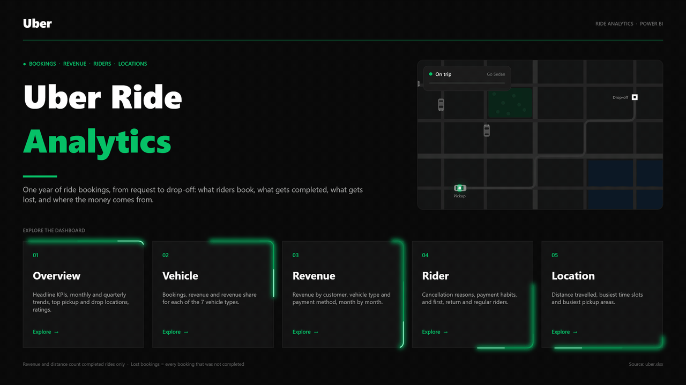
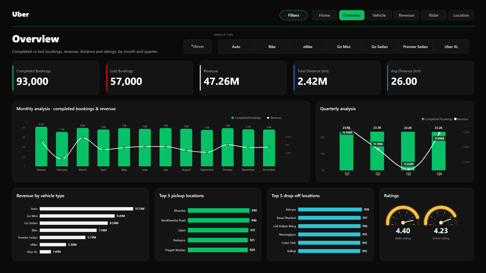
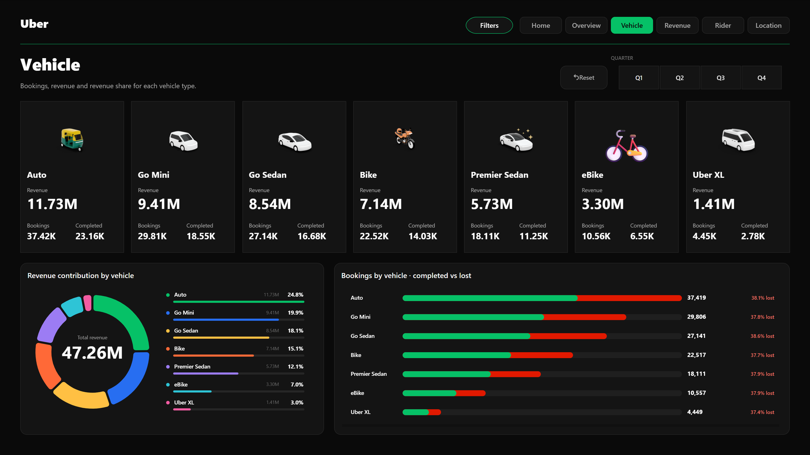
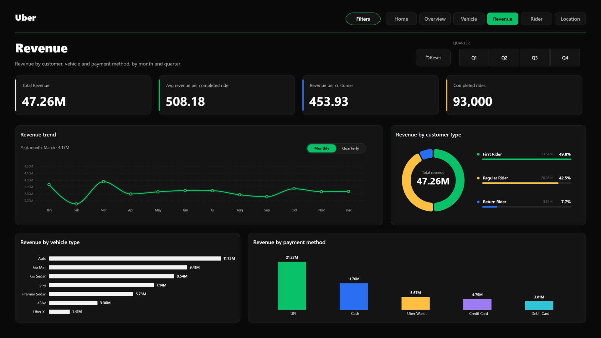
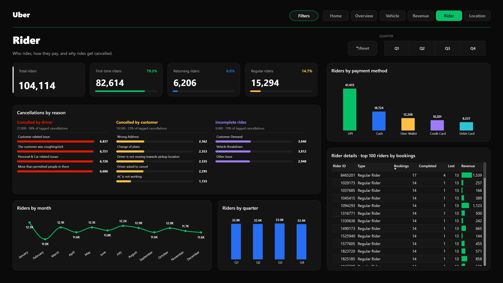
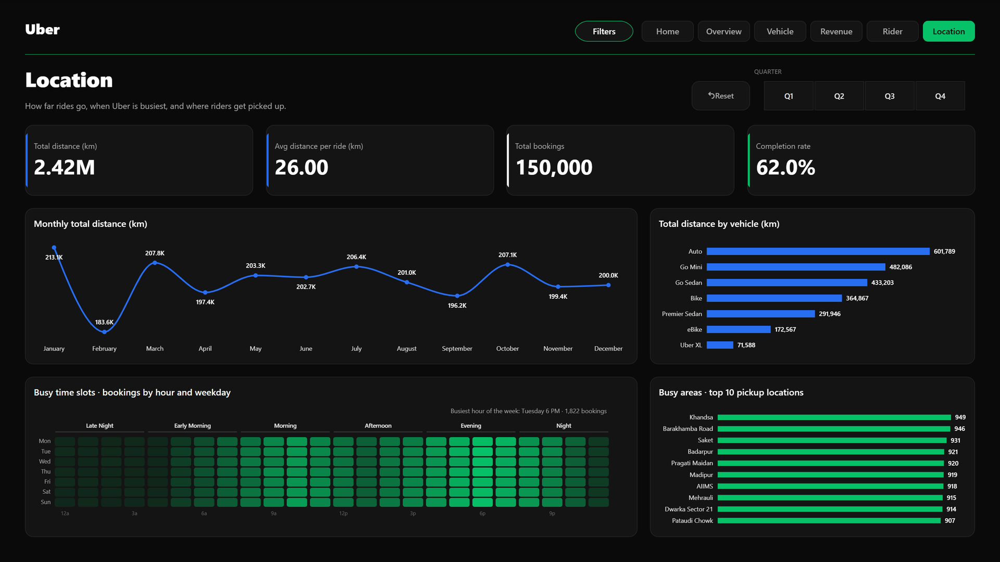
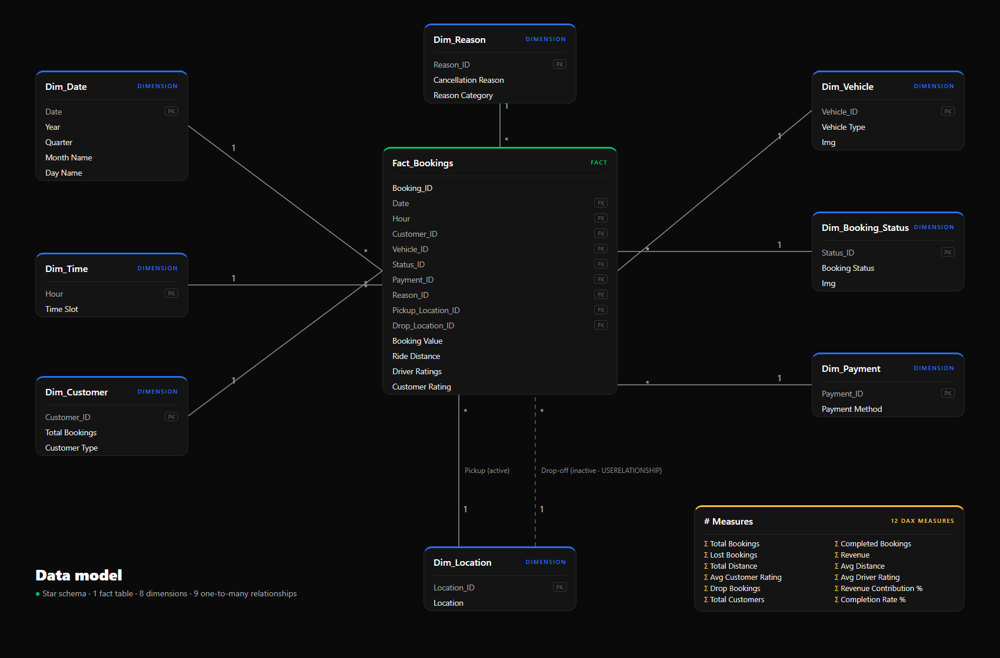

# 🚖 Uber Ride Analytics — Power BI Dashboard

An interactive, dark-themed Power BI report that follows 150,000 ride bookings from request to drop-off: what riders book, what gets completed, what gets lost, and where the money comes from.

**[⬇ Download the .pbix](Uber_Ride_Analytics.pbix)** · **[📄 Business requirements](Uber%20Business%20Requirements.docx)**



---

## Key insights

- **62% of bookings are completed** (93,000 of 150,000). The other 57,000 are lost.
- **Drivers cause the biggest share of lost bookings:** 27,000 driver cancellations, 47% of all lost bookings.
- **Revenue of 47.26M comes from completed rides.** Auto leads with 24.8%, followed by Go Mini (19.9%) and Go Sedan (18.1%). Uber XL brings in only 3%.
- **Every vehicle type completes about 62% of its bookings,** with an average ride of about 26 km. Vehicle types differ by volume, not by reliability.
- **79% of the 104,114 riders booked only once,** so rider retention is the main growth lever.
- **Riders rate trips 4.40 on average and drivers rate riders 4.23.**

## Business requirements

The report answers the brief in [`Uber Business Requirements.docx`](Uber%20Business%20Requirements.docx), which has five parts:

1. **Overview:** KPIs (completed and lost bookings, revenue, total and average distance), a vehicle filter, monthly and quarterly analysis, revenue by vehicle type, the top pickup and drop-off locations, and the average rider and driver ratings.
2. **Vehicle:** bookings, revenue and revenue contribution for each vehicle type.
3. **Revenue:** revenue by customer type, vehicle and payment method, monthly and by quarter.
4. **Rider:** cancellations by reason, payment methods, monthly and quarterly trends, a detail table, and first-time, returning and regular riders.
5. **Location:** monthly total distance, distance by vehicle, busy time slots and busy areas.

Every page also has a hide/show filter panel with several filters.

## Report pages

| Page | What it shows |
|---|---|
| **Home** | Animated landing page: a car driving a route map, plus neon navigation tiles |
| **Overview** | Headline KPIs, completed bookings vs revenue by month and quarter, revenue by vehicle, top 5 pickup and drop-off locations, rating gauges |
| **Vehicle** | One tile per vehicle type (bookings, revenue, completed rides), a revenue-share donut, completed vs lost bookings |
| **Revenue** | Revenue trend with a monthly/quarterly toggle, revenue by rider type, vehicle and payment method |
| **Rider** | First-time, returning and regular riders, payment habits, cancellation reasons, riders by month and quarter, top 100 riders |
| **Location** | Distance by month and vehicle, an hour-by-weekday heatmap of busy times, the 10 busiest pickup areas |

| Overview | Vehicle |
|---|---|
|  |  |
| **Revenue** | **Rider** |
|  |  |
| **Location** | **Data model** |
|  |  |

## Data model

The model is a star schema: one fact table, `Fact_Bookings` (150,000 rows), and 8 dimensions: Date, Time, Vehicle, Booking Status, Payment, Reason, Customer and Location. It has 9 one-to-many relationships, all filtering in a single direction.

- **Location is a role-playing dimension.** Pickup uses the active relationship. Drop-off uses an inactive relationship, which `USERELATIONSHIP` switches on.
- **The Customer dimension segments riders by booking count:** first-time (1 booking), returning (2) and regular (3 or more).
- **Power Query cleaning:**
  - Set data types manually (the first rows are empty, so auto-detection failed).
  - Merged three cancellation-reason columns into one.
  - Grouped hours into 4-hour time slots.
  - Turned booking and customer IDs into numbers.
  - Labelled missing payment methods and reasons as "Not Applicable" instead of leaving blanks.

## DAX highlights

The model has 12 explicit measures. A few of them:

```dax
Completed Bookings =
CALCULATE ( [Total Bookings], KEEPFILTERS ( Dim_Booking_Status[Booking Status] = "Completed" ) )

-- Revenue and distance count completed rides only.
-- KEEPFILTERS keeps the booking-status slicer working instead of overriding it.
Revenue =
CALCULATE ( SUM ( Fact_Bookings[Booking Value] ), KEEPFILTERS ( Dim_Booking_Status[Booking Status] = "Completed" ) )

-- Drop-off counts use the inactive relationship to the Location dimension.
Drop Bookings =
CALCULATE ( [Total Bookings], USERELATIONSHIP ( Fact_Bookings[Drop_Location_ID], Dim_Location[Location_ID] ) )

-- Share of revenue that responds to slicers
Revenue Contribution % =
DIVIDE ( [Revenue], CALCULATE ( [Revenue], ALLSELECTED ( Dim_Vehicle ) ) )
```

## Design and interactivity

- **Theme:** a custom "Uber Night" dark theme (JSON), with green for completed or good results and red only for lost bookings.
- **Animated landing page:** a GIF route map, SVG neon borders and hover effects on the navigation tiles.
- **Deneb (Vega) custom visuals:**
  - hover effects and click-to-filter
  - speedometer-style rating gauges
  - a revenue trend with an animated monthly/quarterly toggle
  - a busy-times heatmap
- **Slide-out filter panel:** built with bookmarks, with 7 synced slicers on every page (month, vehicle, booking status, payment method, rider type, time slot and location).
- **Cross-filtering instead of highlighting,** which keeps the dark theme clean when you click a visual.

## Performance tuning

Performance Analyzer showed that the DAX was fast (under 60 ms per query). The time went into rendering the visuals. Changes made:

- Replaced the new button slicers (0.7–1 s each) with classic tile slicers.
- Merged 21 per-vehicle cards into one visual. The Vehicle page went from 3.0 s to 1.8 s.
- Limited the rider detail table to the top 100 riders.
- Kept 1–3 Deneb visuals per page, used native visuals for the rest, and removed the count-up animations.

**Result:** the Overview page now loads in about half a second, down from about 1.9 s.

## Repository contents

| File | What it is |
|---|---|
| `Uber_Ride_Analytics.pbix` | The finished Power BI report (data included) |
| `data/uber.xlsx` | The raw bookings data used by the report |
| `Uber Business Requirements.docx` | The business brief the dashboard answers |
| `images/` | Screenshots and the animated home-page GIF |

## Tools

Power BI Desktop · Power Query (M) · DAX · Deneb (Vega) · Excel

## How to open

1. Download [`Uber_Ride_Analytics.pbix`](Uber_Ride_Analytics.pbix) and open it in [Power BI Desktop](https://powerbi.microsoft.com/desktop/) (free).
   - The data is already loaded, so you can explore straight away.
   - The Deneb visual comes from Microsoft AppSource, so the first load needs an internet connection.
2. To refresh the data, go to **Transform data → Data source settings → Change source** and point it to `data/uber.xlsx`.

## Dataset

`data/uber.xlsx` holds 150,000 ride bookings from the Delhi NCR region over one year, plus small lookup sheets for vehicle images and booking-status icons.

---

**Ahmed Abozaid** · [LinkedIn](https://www.linkedin.com/in/ahmedabozaid99/)
